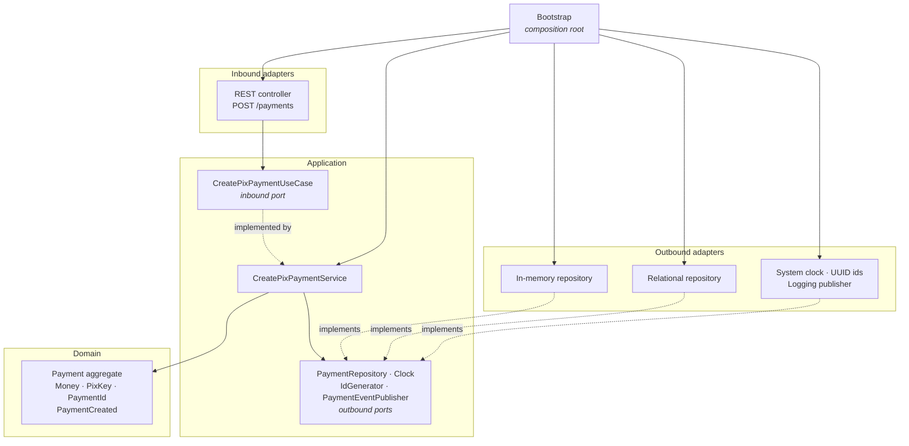

# Architecture plan — SPEC-EXAMPLE-001

How the specification maps onto modules, ports and adapters, and which
decisions were expensive enough to need an ADR.

## Bounded context

One context: `payment`. Layout is *package by bounded context first, hexagonal
layers inside* — see [ADR-0001](../../../docs/decisions/ADR-0001-hexagonal-architecture.md).



Every arrow into the domain points inward. Nothing points out of it, and the two
adapter groups never touch each other.

## Module decomposition

### Java — seven Maven modules

Multi-module rather than packages in one jar, because Maven then **refuses to
compile** a forbidden dependency. A package-level rule is checked by a test that
someone can delete; a module-level rule is checked by the build itself. See
[ADR-0003](../../../docs/decisions/ADR-0003-java-module-boundaries.md).

| Module | Depends on |
| --- | --- |
| `payment-domain` | nothing |
| `payment-application` | `payment-domain` |
| `payment-adapter-in-rest` | application, domain |
| `payment-adapter-out-memory` | application, domain |
| `payment-adapter-out-persistence` | application, domain |
| `payment-bootstrap` | whatever composition requires |
| `payment-architecture-tests` | inspects the modules above |

### Python — one package, layered inside

Python has no module system that can refuse an import, so the boundary is
enforced by Import Linter contracts running as tests. See
[ADR-0004](../../../docs/decisions/ADR-0004-python-import-contracts.md).

```
src/payment/{domain,application,adapters,bootstrap}
```

## Ports

| Port | Direction | Why it exists |
| --- | --- | --- |
| `CreatePixPaymentUseCase` | inbound | The context's offer, independent of transport |
| `PaymentRepository` | outbound | Storage must be swappable and contract-tested |
| `PaymentEventPublisher` | outbound | Messaging technology must not reach the use case |
| `Clock` | outbound | Makes time an input instead of ambient state |
| `IdGenerator` | outbound | Makes identity an input instead of ambient state |

`Clock` and `IdGenerator` were challenged as ceremony during review; the
reasoning for keeping them is recorded in
[CQ-007](clarifications.md#cq-007--should-clock-and-idgenerator-really-be-ports).

## Mapping across boundaries

Three representations of a payment exist, deliberately:

| Representation | Lives in | Shaped by |
| --- | --- | --- |
| `CreatePaymentRequest` / `Response` | inbound adapter | HTTP and JSON |
| `Payment` aggregate | domain | business rules |
| `PaymentRow` | persistence adapter | what a relational store can index and constrain |

Mapping between them is explicit. An automatic mapper would let a new HTTP field
silently become a new domain concept, which is exactly the coupling these
boundaries exist to prevent.

## Cross-cutting decisions

**Error translation (ARCH-011).** Driver exceptions are caught at the adapter
and re-raised as `PaymentRepositoryError` / `EventPublicationError`. Without
this, the application layer would need to catch `SQLAlchemyError` — and would
therefore depend on SQLAlchemy while claiming not to.

**Timezone handling.** `UtcDateTime` in the persistence adapter. The domain
requires an aware timestamp; SQLite cannot store one. The adapter absorbs the
backend difference so the invariant holds identically everywhere. See
[CQ-005](clarifications.md#cq-005--must-created_at-carry-a-timezone).

**Idempotency.** Checked in the use case *and* enforced by a unique index. The
application check handles the common case cheaply; only the database can win a
race between two concurrent requests carrying the same key.

**Event publication.** Save first, publish second. Documented limitation, not a
hidden one — see [CQ-006](clarifications.md#cq-006--what-happens-if-the-event-cannot-be-published).

## ADRs required

| ADR | Decision |
| --- | --- |
| ADR-0001 | Hexagonal architecture per bounded context |
| ADR-0003 | Java multi-module to enforce boundaries at compile time |
| ADR-0004 | Import Linter as the Python architecture fitness function |

## Fitness functions

| Rule | Java | Python |
| --- | --- | --- |
| Domain imports no framework | ArchUnit | `domain-is-framework-free` |
| Application imports no adapter | ArchUnit + Maven | `layers` |
| Adapters are independent | ArchUnit | `adapter-independence` |
| No cycles | ArchUnit slices | `layers` |
| Only bootstrap composes | ArchUnit | `bootstrap-is-not-imported` |
| No ambient time or identity in the domain | ArchUnit | `domain-has-no-ambient-io` |

Each is paired with a negative fixture proving it can fail. A rule that has never
failed is a rule nobody has verified.

## Impact

- **New code only.** No existing behaviour changes.
- **No runtime dependency** is added to anything outside the examples.
- **Build time** grows by the Java multi-module compile and the architecture
  suites; the negative fixtures add a few seconds.
- **Rollback** is deletion. Nothing depends on these modules.
